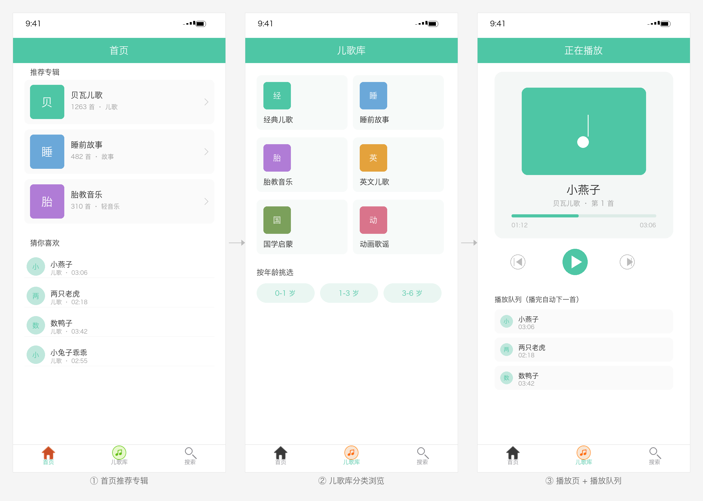

# BabySong

一款**儿童音频 App**，Objective-C 编写。内容围绕儿歌、睡前故事、胎教音乐这一类亲子场景，主打"父母不用自己讲，打开就能放给孩子听"。

界面按内容消费的路径组织：首页推荐 → 分类浏览 → 搜索 → 播放页，四步走完。



> 示意图，非真机截图。三页从左到右：首页推荐专辑 → 儿歌库分类浏览 → 播放页与播放队列。Tab 图标取自项目里的 `tab_0` / `tab_1` / `tab_selected_*` 真实图片，第三个 Tab 与源码一致用系统搜索图标。

## 三个 Tab

| Tab | 作用 |
| --- | --- |
| **首页** | 推荐位 + 内容列表，进来就能直接听 |
| **儿歌库** | 按分类浏览（Sort 页），按类别筛内容 |
| **搜索** | 关键词搜歌曲/故事 |

另有「我的」（`MineViewController`）作为个人页面，从首页入口进入。

## 主要功能

- **音频播放**：`AVPlayer` 驱动，支持播放 / 暂停
- **自动连播**：一首播完自动接着播列表里的下一首，播到最后一条弹提示，不会卡在一首上
- **播放态标识**：正在播放的那条列表项高亮，切歌时把上一条的选中状态清掉
- **封面图**：SDWebImage 异步加载专辑/歌曲封面，滚动不卡
- **下拉刷新**：JHRefresh 下拉加载
- **加载提示**：MMProgressHUD 转圈提示

## 技术要点

**1. 播放器用 AVPlayer 而不是 AVAudioPlayer**
`AVPlayer` + `AVPlayerItem` + `AVPlayerItemDidPlayToEndTimeNotification`。三件套的好处是天然支持网络流（`playUrl32` 是远程 mp3 地址），而 `AVAudioPlayer` 只能放本地文件。播完的通知就是自动连播的触发点。

**2. 列表即播放队列**
`_dataArr` 同时是列表数据源和播放队列，`_currentCount` 记当前播到第几条。播完就把 index + 1，取下一个的 `playUrl32` 重新建 `AVPlayerItem`。不用额外维护一套队列结构。

**3. 分类选择器（DisplayViewController）**
按喜马拉雅专辑维度拉列表数据，`album_id` 不同对应不同分类，切分类就是重新请求一页。

**4. 第三方库手动集成**
`AFNetworking`、`SDWebImage`、`MMProgressHUD`、`JHRefresh` 都是源码直接放进工程目录，**没有走 CocoaPods**。好处是不用装 pod、打开就能编译；代价是版本升级要手动替换。

## 数据来源与凭证配置（重要）

首页和分类列表用的是喜马拉雅的两个公开接口，不需要凭证：

```
http://subapp.ximalaya.com/index/821?page_id=%ld&pageSize=%ld
http://subapp.ximalaya.com/821/bozhus/%ld
```

专辑列表用的是**需要签名的开放接口**：

```
http://api.ximalaya.com/openapi-gateway-app/albums/browse
```

**这个接口的凭证在源码里是占位符，原样跑不通** —— `Define.h` 顶部是：

```objc
#define kXimalayaAppKey     @"YOUR_APP_KEY"
#define kXimalayaNonce      @"YOUR_NONCE"
#define kXimalayaTimestamp  @"YOUR_TIMESTAMP"
#define kXimalayaSig        @"YOUR_SIG"
```

要让这个接口跑起来，需要自己换：

1. 到 [喜马拉雅开放平台](https://open.ximalaya.com/) 注册开发者、创建应用，拿到 **AppKey** 和 **Secret**
2. 打开 `BabySong/Define.h`，把上面四个占位符换成自己的值
3. **`sig` 不是固定字符串**，它是对 `app_key` + `nonce` + `timestamp` + 其他参数用 Secret 计算出来的签名。参数一变签名就变，别处抄来的 sig 一定校验失败，得按官方签名规则自己算
4. `DisplayViewController.m` 里的 `album_id=14501623` 也要换成你想拉取的专辑 ID

> 为什么留占位符：开放平台的凭证属于开发者个人应用，写死在仓库里既会被别人消耗你的调用配额，也容易因公开泄露被平台限制。换成自己的才能稳定用。

不换凭证也不影响看代码和跑界面 —— 只是那一个专辑列表接口会返回签名错误，其余页面照常。

## 怎么跑起来

1. 用 Xcode 打开 `BabySong.xcodeproj`（不需要 workspace，没有 Pods）
2. 部署目标 iOS 8.3，选任意 iPhone 模拟器 Run
3. 如果编译报错找不到某个第三方库的头文件，检查 `BabySong/` 下的 `AFNetworking`、`SDWebImage` 等目录是否还在工程引用的路径里

## 目录结构

```
BabySong/
├── AppDelegate
├── MyTabViewController        三个 Tab 的容器（用类名字符串动态创建）
├── HomeViewController         首页
├── SortViewController         儿歌库分类
├── SearchViewController       搜索
├── DisplayViewController      分类内容列表
├── DetailViewController       详情 + 播放（列表 + 播放器 + 连播）
├── PlayViewController         播放页
├── MineViewController         我的
├── BaseViewController         基类（统一导航栏样式等）
├── PlayModel / MyModel / MyCell
├── AFNetworking/ SDWebImage/ MMProgressHUD/ JHRefresh/    第三方源码
└── Images.xcassets
```

## 已知限制

- 专辑列表接口的 `app_key` / `sig` 是占位符，需要换成自己的凭证（见上文「数据来源与凭证配置」）。
- 没有后台播放（未配置 `UIBackgroundModes: audio`），App 切后台音频会停。
- 没有播放进度条和拖拽，只有播放 / 暂停。
- `UIAlertView` 是 iOS 9 之前的老控件，现在跑会有一条废弃警告。
- 只支持 iOS 8.3 及以上的竖屏布局，没有适配 iPad 和横屏。

## License

未声明。代码可自由参考。
